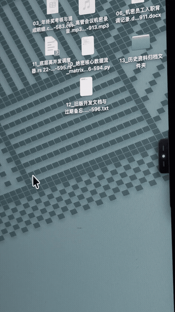

# 屏幕碎纸机 (Screen Shredder)

<p align="center">
  
</p>

<p align="center">
  <strong>一款治愈感满满的桌面拟物交互工具 · 支持 macOS 与 Windows 双平台</strong>
</p>

<p align="center">
  <a href="https://github.com/LionZLH/screen-shredder/releases/latest"></a>
  
  
</p>

---

## ✨ 亮点特色

* 🗄️ **屏幕边缘拟物进纸口**：平时轻隐在屏幕边缘，鼠标或拖拽文件靠近时顺滑滑出；全透明无框体，不阻挡桌面正常操作。
* ✂️ **沉浸式物理拟音与动画**：内置微动开关与机械切纸拟音，伴随真实纸张卷入、齿条粉碎与纸屑掉落物理动效。
* 🎨 **文件类型智能染色**：自动感知拖入文件类型（PDF 鲜红、表格翠绿、图片赭黄、代码文件等），生成对应色泽的真实纸屑。
* 🛡️ **绝对安全的「真删除」**：文件直接安全移入**系统原生回收站**（macOS 废纸篓 / Windows 回收站），随时可以右键一键放回原处，绝不擅自粉碎擦写磁盘。
* 🕶️ **趣味彩蛋**：支持极速连发连碎与神秘的「黑客帝国代码雨」等隐藏视觉效果。

---

## 📥 下载安装

直接前往 [**Releases 发布页**](https://github.com/LionZLH/screen-shredder/releases/latest) 下载对应系统的安装包，双击即可运行，**无需任何开发环境**：

| 系统 | 下载文件 | 说明 |
| :--- | :--- | :--- |
| **macOS (Apple Silicon)** | `*.aarch64.dmg` | M1 / M2 / M3 / M4 芯片 Mac |
| **macOS (Intel)** | `*.x64.dmg` | Intel 处理器 Mac |
| **Windows** | `*-setup.exe` | Windows 10 / 11 64位系统一键安装 |

> **提示**：
> * **macOS 首次打开**：若提示未受信任开发者，前往「系统设置 → 隐私与安全性」点击「仍要打开」即可。
> * **Windows 首次打开**：若提示 SmartScreen 拦截，点击「更多信息 → 仍要运行」即可。

---

## 🛠️ 本地开发构建（仅面向开发者）

如果你想自行修改或编译本项目：

```bash
# 1. 克隆仓库
git clone https://github.com/LionZLH/screen-shredder.git
cd screen-shredder

# 2. 安装前端依赖
npm install

# 3. 启动开发模式
npm run tauri dev

# 4. 构建正式发行包
npm run tauri build
```
